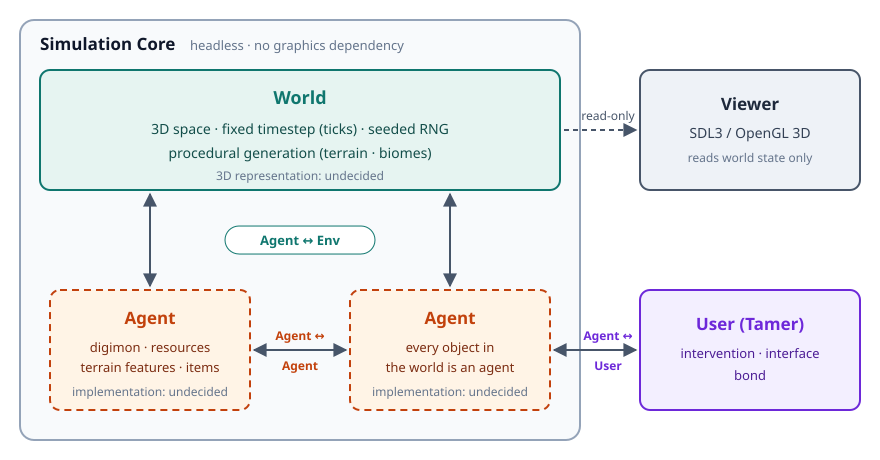
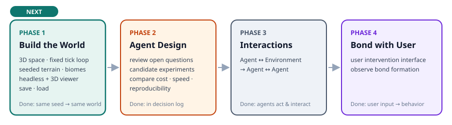

# DIGIMON

> Digital Interactive Generative Intelligence for Multi-agent Organism Networks *(working title, not final)*

A research project inspired by the premise of the *Digimon* anime: digital life forms living autonomously in a parallel world made of data.
We simulate a 3D digital world in C++, turn **every object in it into an agent**, let them interact with one another, and ultimately study the **bond between the user and a digimon**.

## Goals

1. Build a 3D digital world that runs on its own.
2. Make every object in the world an agent, and let agents interact with the environment, with each other, and with the user.
3. Study whether a bond forms between the user and an agent (digimon), and whether it affects the agent's behavior.

## Architecture



| Category | Name | Description |
|---|---|---|
| Frame | World | The 3D space and time agents exist in. Ticks, procedural generation. |
| Entity | Agent | Every object in the world (digimon, resources, terrain features, items, etc.). |
| Interaction | Agent ↔ Environment | Perceiving the world (terrain, biomes, time, etc.) and acting on it. Movement, terrain effects, terrain modification, etc. |
| Interaction | Agent ↔ Agent | Interactions between agents. Feeding, combat, communication, etc. |
| Interaction | Agent ↔ User | User (tamer) intervention, bond, interface. |

## Engine Design Principles

1. **Separate simulation and rendering** — The simulation core does not depend on graphics code and must be able to run headless, faster than real time. The viewer only reads world state.
2. **Fixed timestep** — The world advances in ticks.
3. **Seed-based reproducibility** — The same seed should produce the same result. Randomness comes only from a seeded RNG owned by the world.
4. **3D by design** — The world is designed in 3D from the start. Space, coordinates, and physics in the simulation core are 3D as well.

## Roadmap



| Phase | Scope | Done when |
|---|---|---|
| 1. Build the world | Choose the 3D world representation, 3D space and fixed tick loop, seed-based procedural generation (terrain, biomes), headless mode and SDL3/OpenGL 3D viewer, world save/load | The same seed generates the same world, and both headless and viewer modes run. |
| 2. Decide agent design | Review the open questions, compare candidates on cost, performance, and reproducibility through small experiments | The agent design is recorded in the decision log. |
| 3. Implement interactions | Agent ↔ Environment, then Agent ↔ Agent | Agents can be observed acting on their own and affecting each other in the world. |
| 4. Bond with the user | Interface for user intervention, observing how bonds form and what they change | User interaction is reflected in agent behavior. |

**Current status:** Phase 1 not started yet (begins when 3D graphics study begins). See [docs/PLAN.md](docs/PLAN.md#진행-상황) for the latest progress.

## Open Questions

Building the agents is the core of this project, and the design will be decided in Phase 2 through experiments. Until then, the following remain undecided:

- Agent internals (state-based / rules / SLM / LLM / hybrid)
- Agent representation (ECS / class objects / other)
- How agent actions are applied to the world, and how agents communicate
- The boundary between environment and agents, and whether world space itself is an agent
- Implementation of evolution (digivolution), memory, personality, and bond
- 3D world representation (voxels / heightmap terrain + 3D coordinates / continuous 3D space, etc.)

Details and references are in [docs/PLAN.md, Section 7](docs/PLAN.md#7-agent-설계--미정).

## Build

Stack: Modern C++, CMake, Git, SDL3, OpenGL

> There is no source code yet. Once code is added, build with:

```bash
cmake -S . -B build
cmake --build build
```

Test and run instructions will be added once the repository layout is settled.

## Documents

- [docs/PLAN.md](docs/PLAN.md) — plan, architecture, schedule, risks, decision log, progress (Korean)
- [CLAUDE.md](CLAUDE.md) — working rules for AI-assisted development (Korean)

## License and Notice

- Code: [Apache License 2.0](LICENSE)
- This is a personal research project inspired by the *Digimon* setting and is not affiliated with the original rights holders. No character art or original setting text is used; all species and world lore are original.
